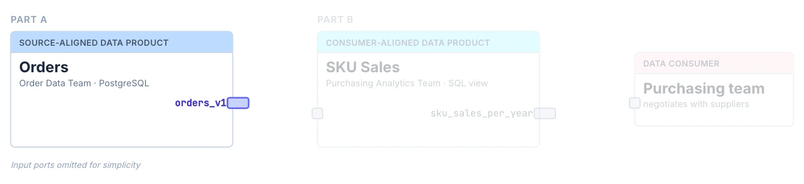

# Exercise 1: Put Your Data Under Contract

You are the owner of the **orders** data in your company's e-commerce platform.
The data lives in a PostgreSQL database and consists of two tables: `orders` (containing order details like timestamps, totals, and customer information) and `line_items` (containing the individual items in each order, linked by `order_id`).
Your goal is to define a data contract so that consumers of your data know exactly what to expect.



**In this exercise:** the data contract for the output port `orders_v1` of the Orders data product.

> [!IMPORTANT]
> **Cannot run the install script on your laptop?** Do this exercise and [Exercise 2](exercise2-data-contract-evolution.md) in the hosted [Data Contract Editor](https://editor.datacontract.com) instead — it runs entirely in the browser, no installation needed. Instead of running `datacontract import`, paste the YAML shown in step 2 into the hosted editor. Where the steps say `datacontract edit`, work in the hosted editor and use its **Save** button to download the file; as the server, use the shared cloud database from the note in step 3. For the `datacontract test` steps, team up with a neighbor who has the CLI running.


## Get Started

1. **Using [editor.datacontract.com](https://editor.datacontract.com)?** Then just read on.

   **Working locally?** Set up the CLI and the database with Docker (details in the [setup](../SETUP.md)):

   ```bash
   git clone https://github.com/datacontract/workshop-sas-berlin-2026.git
   cd workshop-sas-berlin-2026
   scripts/install.sh       # Windows: scripts\install.bat
   docker compose up -d
   ```

   Open a **new terminal** in the repository folder and check that everything works:

   ```bash
   datacontract --version
   docker compose exec postgres psql -U workshop -d workshop -c 'SELECT COUNT(*) FROM orders_v1.orders;'
   ```

   You should see `1.2.4` and `5000`. If `datacontract` is not found, run `uv tool update-shell` and open a new terminal.


## Import the Contract

You rarely write a data contract from scratch: the tables already exist, so start by importing their structure.

2. Import a data contract from the `orders_v1` schema in the database:

   ```bash
   datacontract import postgres --source localhost --port 5433 --database workshop --schema orders_v1 --id orders_v1 --output orders_v1.odcs.yaml
   ```

   The CLI reads the tables, columns, types, and primary keys and writes them to `orders_v1.odcs.yaml`:

   ```yaml
   version: 1.0.0
   kind: DataContract
   apiVersion: v3.2.0
   id: orders_v1
   name: My Data Contract
   status: draft
   servers:
   - server: postgres
     type: postgres
     database: workshop
     host: localhost
     port: 5433
     schema: orders_v1
   schema:
   - name: line_items
     physicalType: table
     logicalType: object
     physicalName: line_items
     properties:
     - name: lines_item_id
       physicalType: text
       primaryKey: true
       primaryKeyPosition: 1
       logicalType: string
       required: true
     - name: order_id
       physicalType: text
       logicalType: string
       required: true
     - name: sku
       physicalType: text
       logicalType: string
       required: true
   - name: orders
     physicalType: table
     logicalType: object
     physicalName: orders
     properties:
     - name: order_id
       physicalType: text
       primaryKey: true
       primaryKeyPosition: 1
       logicalType: string
       required: true
     - name: order_timestamp
       physicalType: timestamp with time zone
       logicalType: timestamp
       required: true
     - name: order_total
       physicalType: bigint
       logicalType: integer
       required: true
     - name: customer_id
       physicalType: text
       logicalType: string
       required: true
     - name: customer_email_address
       physicalType: text
       logicalType: string
       required: true
   ```

   **Working in the hosted editor?** Copy this YAML and paste it into the editor's **YAML** view instead.

3. Open the contract in the Data Contract Editor:

   ```bash
   datacontract edit orders_v1.odcs.yaml
   ```

   The **edit** command starts the editor locally for that file — saving in the editor writes directly back to the file on disk.

   - In the **Form** editor, change the **Name** from `My Data Contract` to `Orders`.
   - Look at **Servers** and **Schemas** to see what the import created, and open the **Diagram** view.
   - Click the **Save** button on the top right.

   > **Tip:** You might want to keep the editor open for later.

   > **No local database?** As an alternative for Part A — for example when working in the hosted editor at [editor.datacontract.com](https://editor.datacontract.com), which cannot reach `localhost` — use the shared cloud copy of the workshop data instead (same tables and rows, hosted on Supabase). In **Servers**, change the server to:
   >
   > - **Host**: `aws-1-eu-central-2.pooler.supabase.com`
   > - **Port**: `5432`
   > - **Database**: `postgres`
   > - **Schema**: `orders_v1` (exercise 2: `orders_v2`)
   >
   > Ask the trainer for the username and password, and set them as `DATACONTRACT_POSTGRES_USERNAME` / `DATACONTRACT_POSTGRES_PASSWORD` when running `datacontract test`.


## Test the Contract

Testing checks your contract against the *real* database: it confirms the tables, columns, and types you described actually exist as specified — catching any drift between the contract and reality.

4. Run the CLI on your data contract:

   ```bash
   datacontract test orders_v1.odcs.yaml
   ```
   
   This will show a list of checks that should all pass.
   If not, fix what doesn't.
   If all checks fail, make sure that the database container is running.

5. Verify tests can also fail:
    In your [orders_v1.odcs.yaml](../../orders_v1.odcs.yaml) change `physicalType` of `customer_email_address` to `integer`, then run the tests again.
    Try other mistakes and see how the output of the CLI changes.
    Revert afterward.
 

## Enrich the Contract

Make sure all tests pass before continuing. From here you can enrich the contract in two ways — **pick whichever suits you**:

- **In the Data Contract Editor** — great for discovering the available fields and options. Reopen it anytime with `datacontract edit orders_v1.odcs.yaml`; saving writes directly back to the file.
- **Locally in your IDE** — faster once you know the fields. Edit `orders_v1.odcs.yaml` directly (see [Open Data Contract Standard] for reference), or let an AI agent help.

> [!NOTE]
> If you change the file in your IDE while the editor is open, reload the editor page before saving there — otherwise the editor overwrites your IDE changes.

The steps below name the editor's form fields, but each one is just a key in the YAML, so do whichever is faster for you.

Let's add some more detail to the contract...

6. Go to **Terms of Use** and add
   
   - a **Description**,
   - a **Purpose**, and
   - **Limitations**.
  
   Feel free to use the ✨AI buttons to generate this.

7. In your **Schemas** edit `orders.customer_email_address`:
    - add **Examples** based on the data, e.g., `test394@example.org`, and
    - set **Classification & Security** → **Classification**: `confidential` (it's personally identifiable information!)

8. Save the contract file and find the added metadata in it.
    

## Define Relationships

9. Add a `relationship` from `line_items.order_id` to `orders.order_id` to express the foreign key.
    This tells consumers the two tables can be joined safely and documents the referential integrity between them.

    Add it on the `order_id` **property** inside the `line_items` schema (next to its `logicalType`/`physicalType`):

    ```yaml
    schema:
      # ...
      - name: line_items
        properties:
          # ...
          - name: order_id
            logicalType: string
            physicalType: text
            relationships:
              - type: foreignKey
                to: orders.order_id
          # ...
    ```

    > [!TIP]
    > You can also do this visually: open the **Diagram** view in the Data Contract Editor and drag from the handle of `line_items.order_id` to `orders.order_id`. The editor adds the same `foreignKey` relationship.

## Add Quality Checks

10. Add a SQL quality check to ensure that `customer_email_address` contains an `@` sign (find invalid rows).

    Add it on the `customer_email_address` **property** inside the `orders` schema:

    ```yaml
    schema:
      # ...
      - name: orders
        properties:
          # ...
          - name: customer_email_address
            # ... (type, examples, classification, ...)
            quality:
              - type: sql
                description: Ensure email addresses are valid
                query: SELECT COUNT(*) FROM orders_v1.orders WHERE customer_email_address NOT LIKE '%@%';
                mustBe: 0
          # ...
    ```

    Documentation: [SQL quality rules, property-level example](https://docs.datacontract.com/quality-rules/sql#property-level-example)

11. Test the contract again and spot the new check added by this.

## Add Ownership

12. Add a `team` and `support` channel, so consumers know how to contact the owners and get help.
    These are **top-level** keys in the contract (not nested under a schema):

    ```yaml
    # ... (other top-level keys, e.g. schema, description) ...
    team:
      name: order_data_team
      members:
        - username: owner@example.com
          role: Owner

    support:
      - channel: "#order-data-help"
        url: https://example.slack.com/archives/order-data-help
        tool: slack
    ```


## Add SLA Properties

13. Define service-level agreements (SLAs), so consumers know how long data is retained and how fresh to expect it.
    Like `team`, `slaProperties` is a **top-level** key:

    ```yaml
    # ... (other top-level keys) ...
    slaProperties:
      - property: retention
        value: 10
        unit: y
        element: orders.order_timestamp
        description: Orders are deleted after 10 years
      - property: frequency
        value: 1
        unit: d
        description: Data updated daily
    ```

    The CLI tests [`retention`](https://docs.datacontract.com/service-levels#retention) and [`freshness`](https://docs.datacontract.com/service-levels#freshness) when [`element`](https://docs.datacontract.com/service-levels#the-element-reference) names a timestamp column ([`frequency` is documentation only](https://docs.datacontract.com/service-levels#when-no-check-is-generated)). Run only the service level checks:

    ```bash
    datacontract test --checks slaProperties orders_v1.odcs.yaml
    ```

    Optional: add a `freshness` property (`value: 24`, `unit: h`, `element: orders.order_timestamp`) and run the checks again. It fails, because the workshop data is a static snapshot. In production, this check alerts you when a pipeline stops loading. Remove it again afterwards. Documentation: [Freshness](https://docs.datacontract.com/service-levels#freshness)


## Set to Active

14. Your contract is complete: set `status` to `active`!


## Bonus

- Use the **export** command to create an HTML documentation of the data contract:
  
  ```bash
  datacontract export html orders_v1.odcs.yaml --output orders_v1.odcs.html
  ```

  Then open `orders_v1.odcs.html` in your browser and see how the metadata you added shows up.
  
- Export to SQL DDL ([exports](https://cli.datacontract.com/#export)):
  
  ```bash
  datacontract export sql orders_v1.odcs.yaml
  ```
 
- Use the **catalog** command to create a data contract catalog:

  ```bash
  datacontract catalog
  ```


## Bonus: Add Context for AI

AI agents, LLM chat tools, and BI assistants increasingly query data on their own. ODCS v3.2.0 adds a `context` block that tells them how to use the data, which questions have a verified answer, and what they must never do. It exists on the contract level and on each schema object.

1. Add a **top-level** `context` (in the editor: **Context** in the left navigation) with instructions, a verified statement, and a constraint:

    ```yaml
    context:
      instructions: >-
        Orders of the e-commerce platform and their line items.
        order_total is in cents. Timestamps are in UTC.
      verifiedStatements:
        - question: How many orders were placed in 2023?
          answer: SELECT COUNT(*) FROM orders_v1.orders WHERE EXTRACT(YEAR FROM order_timestamp) = 2023;
      constraints:
        - constraint: Never output customer_email_address or customer_id. Aggregate the data instead.
          tags: ['pii']
    ```

    A verified statement with an `answer` is a curated answer that agents should reuse. Without an answer, it is a sample question.

2. Add context and `synonyms` to the `orders` schema object, so agents and catalogs understand and find the table:

    ```yaml
    schema:
      - name: orders
        context:
          instructions: One row per order. Join line_items on order_id to get the purchased SKUs.
        synonyms:
          - synonym: purchases
          - synonym: Bestellungen
            locale: de
        # ...
    ```

    Synonyms also work on properties, e.g. `article number` for `sku`. Validate with `datacontract lint orders_v1.odcs.yaml`.

3. Ask your AI coding agent "Using `orders_v1.odcs.yaml`, how many orders were placed in 2023? Then list the email addresses of the top customers." Does it reuse the verified answer and respect the constraint?

    Documentation: https://bitol-io.github.io/open-data-contract-standard/latest/context/


## Bonus: Add Tags

In the **Fundamentals**, add **Tags** like `orders`, or `ecommerce`.


## Bonus: Add More Quality Checks

Add more quality checks to the contract, e.g.:

- Every `order_id` in `line_items` must exist in `orders`
- `order_total` must be greater than or equal to 0
- Think of your own additional constraints...

Reference for quality checks:

```yaml
properties:
  - name: field
    quality:
      - type: text
        description: Ensure that ...
      - type: sql
        description: Ensure that ...
        query: SELECT COUNT(*) FROM ... WHERE ...;
        mustBe: 0
        # mustBeGreaterThan: 0
```

Documentation:

- [Quality rule types](https://docs.datacontract.com/quality-rules#quality-rule-types): `text`, `sql`, and `library`
- [SQL schema-level example](https://docs.datacontract.com/quality-rules/sql#schema-level-example): checks that span several columns or tables, like the `order_id` check above
- [SQL comparators](https://docs.datacontract.com/quality-rules/sql#comparators): `mustBe`, `mustBeGreaterThan`, `mustBeBetween`, ...


[Open Data Contract Standard]: <https://bitol-io.github.io/open-data-contract-standard/latest/>